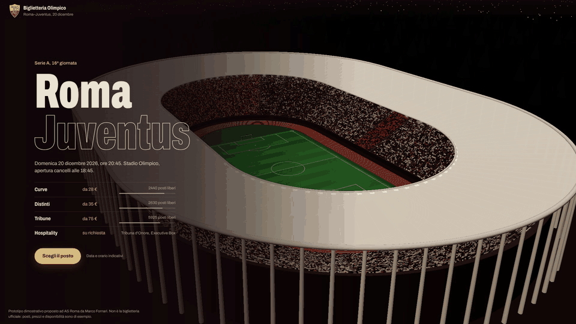
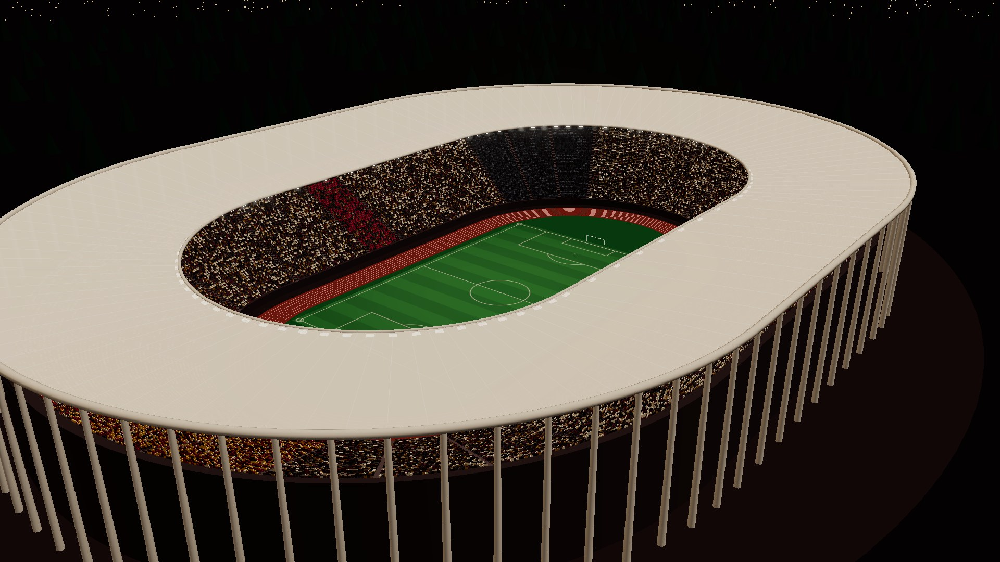
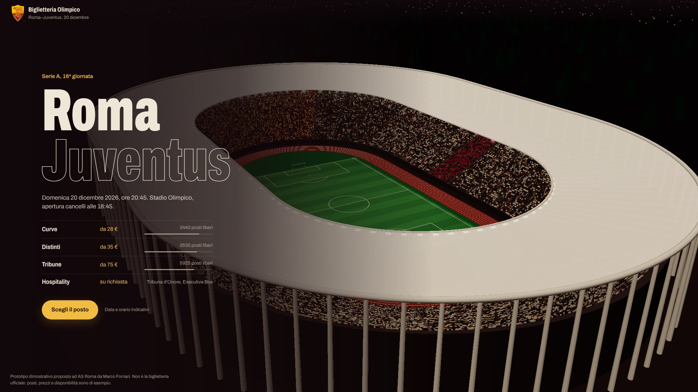
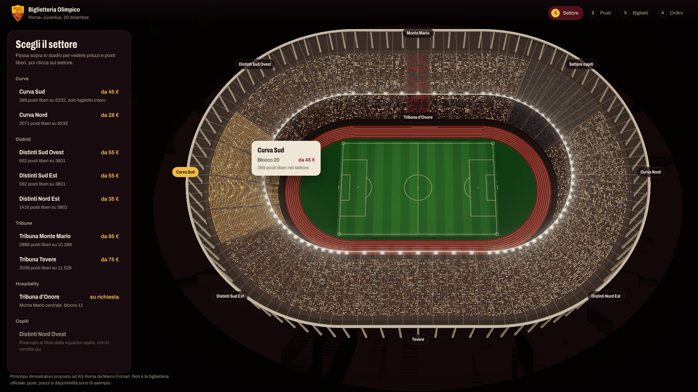
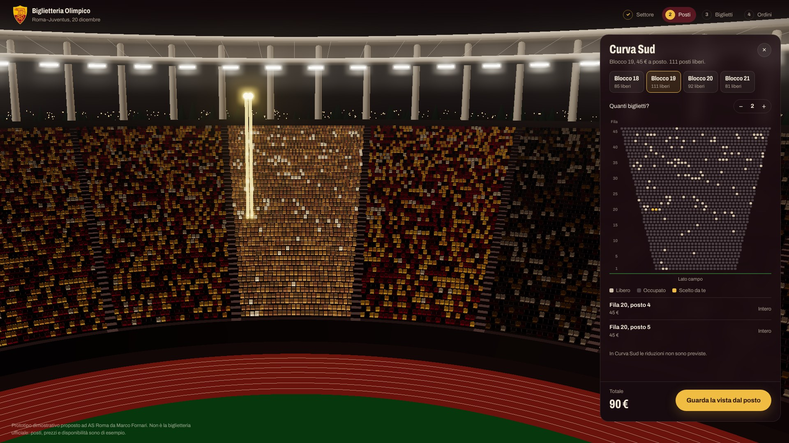
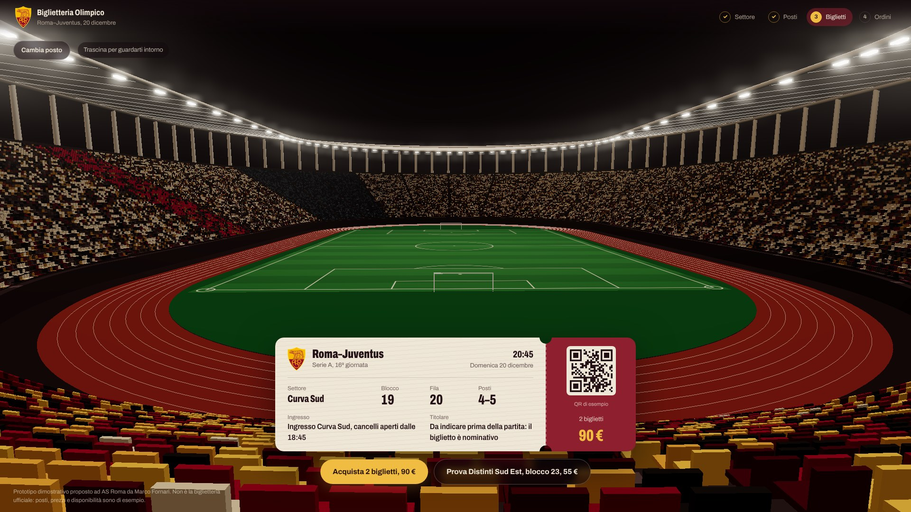
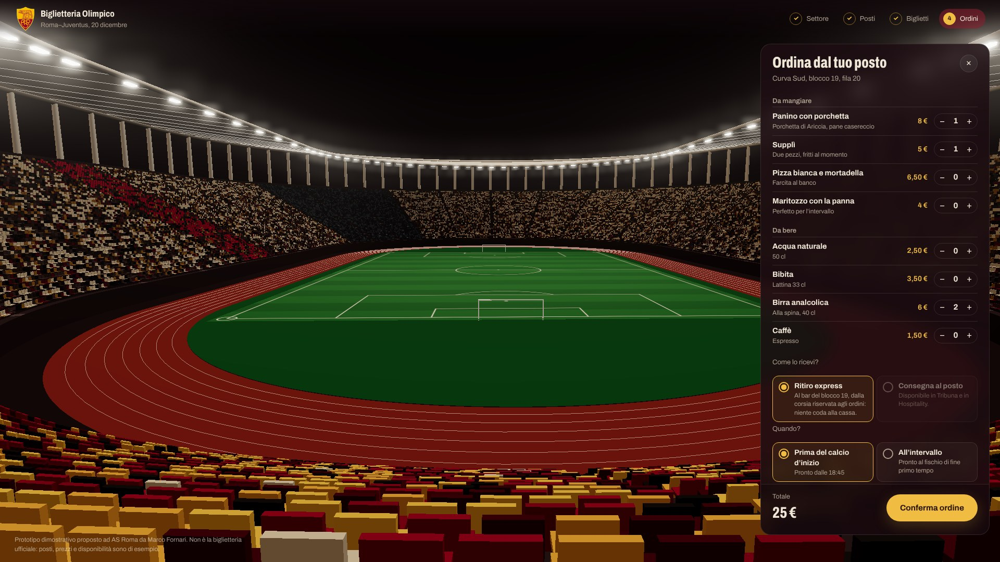
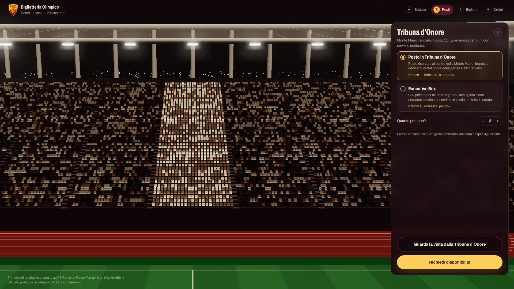
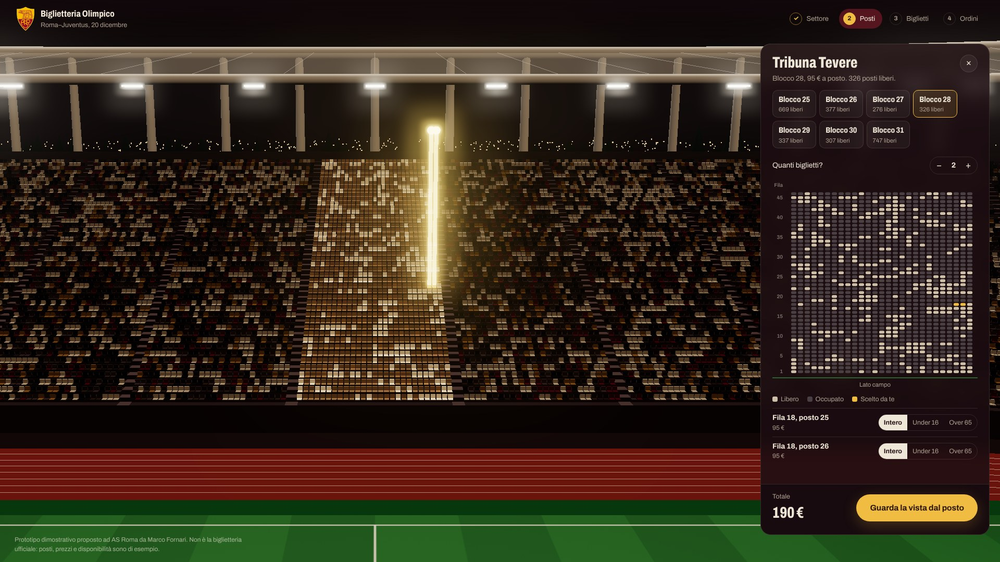

# Biglietteria Stadio Olimpico, prototipo per AS Roma

Prototipo interattivo di biglietteria con ordini dal posto per lo Stadio Olimpico.
Progetto e sviluppo di Marco Fornari. Proposta non ufficiale: posti, prezzi e disponibilità sono di esempio.

<p align="center">
  
</p>

## Anteprima

| | |
|:---:|:---:|
|  |  |
| **Lo stadio in 3D**, con la copertura a 88 campate | **La partita**: data, settori e prezzi di partenza |
|  |  |
| **1. Settore**: prezzo e posti liberi al passaggio del mouse | **2. Posti**: blocco, numero di biglietti e posti vicini |
|  |  |
| **3. Biglietti**: la vista reale dal posto scelto | **4. Ordini**: cibo e bevande, ritiro express o consegna al posto |
|  |  |
| **Tribuna d'Onore**: richiesta di disponibilità all'hospitality | **Tribuna Tevere**: tariffe Intero, Under 16 e Over 65 |

Le altre schermate sono nella cartella [`immagini/`](immagini/).

## Aprirlo

GitHub non esegue le pagine HTML: per provare il prototipo scarica [`main.html`](main.html) (pulsante *Download raw file*) e aprilo in locale.

Apri `main.html` in un browser recente con WebGL 2 e accelerazione grafica attiva. Le geometrie, le texture e i dati del paesaggio sono incorporati nel file. La visita funziona offline.

All'apertura compare il panorama 3D. Trascina per ruotare intorno allo stadio, usa la rotella per lo zoom e premi **Avvia visita** per raggiungere la tribuna. I quattro pulsanti spostano la camera lungo il percorso. Il cursore consente di avanzare o tornare indietro. Lungo il percorso puoi guardarti intorno trascinando o usando i tasti freccia quando il campo ha il focus. **Biglietteria** apre il percorso di prenotazione.

`?biglietteria` apre la locandina, `?tour` avvia la presentazione automatica della biglietteria, `?low` riduce il carico grafico, `?nobloom` disattiva il bagliore. Il tasto T gestisce la presentazione della biglietteria. Le immagini nella cartella `immagini/` documentano la prima versione.

## Il percorso

1. **Settore.** Lo stadio visto dall'alto. Passando sopra un settore si vedono prezzo e posti liberi; il settore ospiti non è in vendita.
2. **Posti.** Si sceglie il blocco e quanti biglietti servono (da 1 a 4). Un clic sulla mappa prende posti vicini nella stessa fila. Le tariffe Intero, Under 16 e Over 65 si applicano dove previste; in Curva Sud solo intero.
3. **Biglietti.** La camera scende al posto scelto e mostra la vista reale sul campo, con il biglietto nominativo. Da qui si può acquistare o provare la fascia superiore: Curva, Distinti, Tribuna, Tribuna d'Onore.
4. **Ordini.** Dopo l'acquisto si ordina da mangiare e da bere: ritiro express al bar del proprio blocco oppure consegna al posto, in Tribuna e in Hospitality, prima della partita o all'intervallo.

La Tribuna d'Onore porta a una richiesta di disponibilità per il team hospitality, invece che a un acquisto diretto.

## Com'è fatto

- Scena Three.js in metri, ancorata al campo e alla sagoma cartografata. Con una chiave Google il contesto arriva dalle Photorealistic 3D Tiles, tramite la libreria 3d-tiles-renderer. Ortofoto del Foro Italico sul terreno in rilievo, pini e bosco, Stadio dei Marmi e copertura a 88 campate. I dettagli di facciate e ingresso sono ricostruiti.
- I riferimenti, le trasformazioni e le approssimazioni sono documentati in `FONTI.md` nella cartella dei sorgenti.
- L'interfaccia di biglietteria usa la palette giallorossa, lo stemma e il carattere Archivo.
- Il comando di compilazione incorpora asset e codice in un unico HTML.

## Modificarlo

Partita, settori, prezzi, menu e testi dell'hospitality sono in `src/config.js`.

```
npm install
node build.mjs     # crea dist/index.html
```

## Contesto 3D da Google Maps

Il paesaggio intorno allo stadio può arrivare dalle **Photorealistic 3D Tiles** di Google Maps Platform (Map Tiles API) invece che dalla cartografia OpenStreetMap inclusa. Lo stadio, la copertura, le gradinate e gli interni restano il modello ricostruito. Le tile di Google forniscono il terreno, il Foro Italico, lo Stadio dei Marmi, Monte Mario e il quartiere. Sotto la sagoma dello stadio le tile vengono spianate, così l'Olimpico fotografato da Google non si sovrappone al modello.

- **Senza chiave** non cambia nulla: la scena usa la cartografia inclusa e funziona offline.
- **Con la chiave** il contesto viene caricato in streaming e serve una connessione internet. Se Google non risponde entro 25 secondi, o se la chiave non è valida, la scena torna da sola alla cartografia inclusa.

### Creare la chiave

1. Su [Google Cloud Console](https://console.cloud.google.com/) crea un progetto e collega un account di fatturazione. Google Maps Platform prevede una quota mensile gratuita; i prezzi sono su [mapsplatform.google.com/pricing](https://mapsplatform.google.com/pricing/).
2. In *API e servizi → Libreria* abilita **Map Tiles API**.
3. In *API e servizi → Credenziali* crea una **chiave API**. Nelle restrizioni limita la chiave alla sola Map Tiles API e ai referrer HTTP da cui la userai, ad esempio `http://localhost:*/*` e il dominio finale.

### Usarla

- Per provarla senza ricompilare apri `main.html?gkey=LA_TUA_CHIAVE`.
- Per includerla nel file inseriscila in `GOOGLE_3D.apiKey` dentro `src/config.js` ed esegui `node build.mjs`. La chiave resta leggibile da chiunque abbia il file: non condividere copie con la chiave dentro, oppure usa una chiave limitata per referrer.
- Le restrizioni per referrer non funzionano aprendo il file con doppio clic (`file://`), perché in quel caso il browser non invia nessun referrer. Per la presentazione servi la cartella in locale, ad esempio con `npx serve dist` e l'indirizzo `http://localhost:3000`, oppure pubblicala sul dominio autorizzato.
- `?osm` forza la cartografia inclusa anche quando una chiave è configurata.

### Allineamento

Il modello è ancorato al centro del campo (41.933886 N, 12.454786 E) con l'asse del campo ruotato di −16,5° rispetto al nord. Lo Stadio dei Marmi cade a circa 5 m dalla posizione cartografata. La quota viene misurata in automatico sul piazzale intorno allo stadio. Per rifinire l'allineamento apri la pagina con `?gkey=…&calibra`. Il pannello consente di spostare il modello verso nord o verso est e di correggere azimut e quota. Copia poi i valori mostrati in `GOOGLE_3D` dentro `src/config.js`.

### Attribuzioni

Quando le tile sono a schermo compare in basso a destra la dicitura **Google Maps**, con i fornitori dei dati restituiti dall'API. La dicitura indica anche quale parte della scena arriva da Google e quale è ricostruita, come chiedono le [policy della Map Tiles API](https://developers.google.com/maps/documentation/tile/policies). Al posto del testo puoi usare il logo ufficiale scaricabile da quella pagina: salvalo accanto al file e indicane il percorso in `GOOGLE_3D.logoUrl`.

## Cosa è dimostrativo

- Disponibilità dei posti generata a caso. Prezzi indicativi presi dai listini pubblici del club. Numerazione dei blocchi indicativa.
- Nessun pagamento e nessun dato personale raccolto. QR e codici ordine sono finti.
- Data e orario di Roma–Juventus sono indicativi.
- Stemma e colori di AS Roma sono usati solo per presentare questa proposta al club. Prima di pubblicarlo online o di usarlo pubblicamente serve l'autorizzazione di AS Roma.
